# 4.1 Student Records Manager: A PHP and MySQL CRUD Project

[Back to Module 4 notes](../README.md)

## Summary

In this project I built a small web application that stores student records in a database and lets a user view, change and remove them from a web page. It is a first step into database driven development, where a web page, a server side script and a database all work together.

The project covers the four basic operations that almost every data driven application relies on, known as CRUD: Create, Read, Update and Delete.

## What the project does

| Operation | What it means | How it is done in this project |
|---|---|---|
| Create | Add new records | An SQL INSERT statement run in phpMyAdmin |
| Read | Display records | `index.php` shows every student in an HTML table |
| Update | Change a record | `update.php` changes a student's email address |
| Delete | Remove a record | `delete.php` removes one student |

The application does not have an "add student" form yet. That is the first item on my improvement list at the end of this report.

## Environment

| Item | Detail |
|---|---|
| Operating system | Windows 11 in a VirtualBox virtual machine |
| Package | XAMPP 8.5.13 |
| Web server | Apache 2.4.71 |
| Server side language | PHP 8.5.13 |
| Database | MariaDB 10.11.19 (MySQL compatible), managed with phpMyAdmin 5.2.3 |
| Editor | Visual Studio Code |
| Browser | Microsoft Edge |

MariaDB is the database that comes with XAMPP. It was created from MySQL and uses the same SQL language, so everything in this project works the same way on MySQL.

## Step 1: Start the web server and the database

I opened the XAMPP Control Panel and started two services. Apache is the web server that delivers pages to the browser. MySQL is the database service. Both turned green, showing they were running. Apache uses ports 80 and 443 and the database uses port 3306.

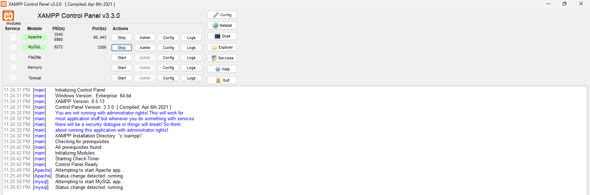

## Step 2: Open phpMyAdmin

phpMyAdmin is a web based tool for managing databases. I opened it at `localhost/phpmyadmin`. Its home page also confirms the software versions in use.

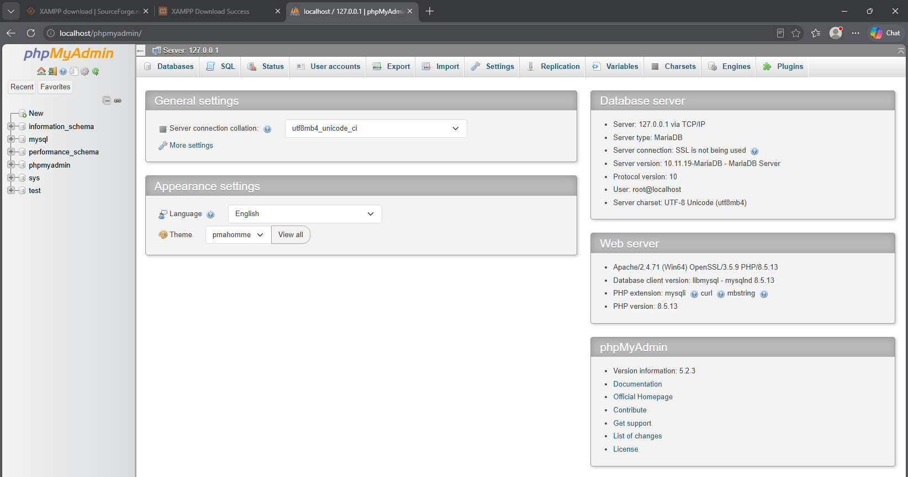

## Step 3: Create the database

A database is a container that holds related tables. I created one called `student_records`.

```sql
CREATE DATABASE student_records;
```

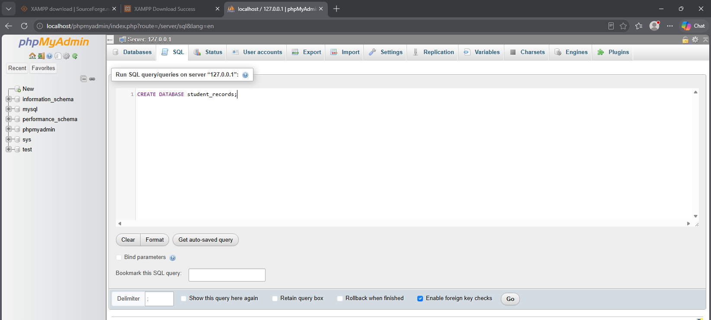

After running it, the new database appears in the list and in the left sidebar.

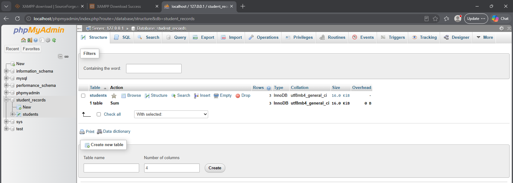

## Step 4: Create the students table

Next I created a table to hold the student information.

```sql
CREATE TABLE students (
    id INT AUTO_INCREMENT PRIMARY KEY,
    name VARCHAR(100),
    age INT,
    email VARCHAR(100)
);
```

* **id** is a whole number that uniquely identifies each student. The database assigns it automatically, starting at 1, and no two students can share one. This is the primary key.
* **name** and **email** hold text of up to 100 characters.
* **age** holds a whole number.

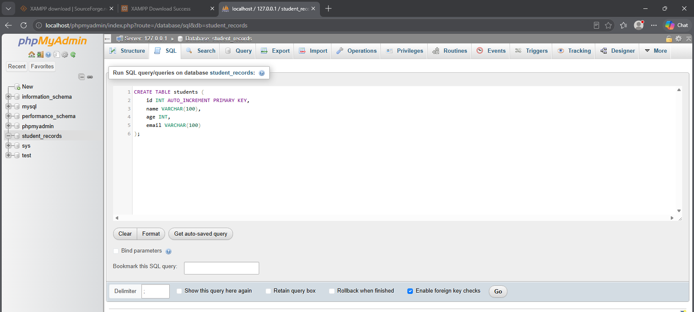

The Structure tab confirms the four columns, with `id` marked as the primary key with auto increment.

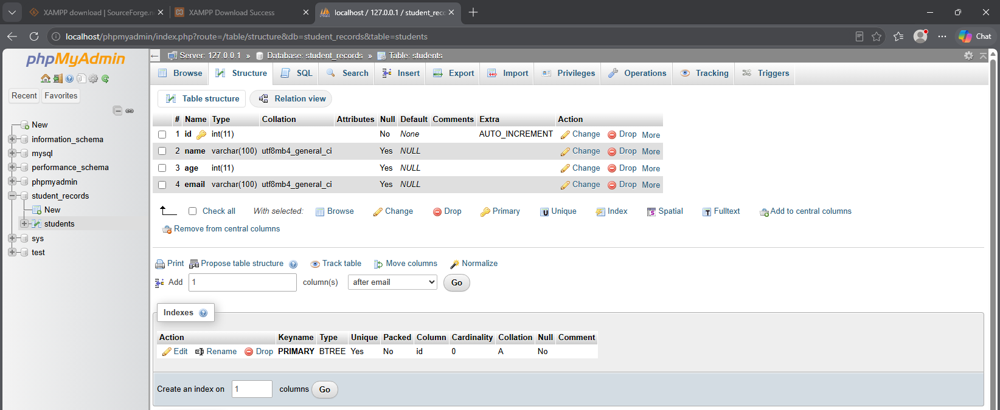

## Step 5: Insert sample records

I added three sample students. All names and email addresses are sample data, and the emails use the reserved `example.com` domain so no real personal information is stored.

```sql
INSERT INTO students (name, age, email) VALUES
('Angel Musomba', 20, 'angel@example.com'),
('Brian Kiggundu', 22, 'brian@example.com'),
('Cynthia Lee', 19, 'cynthia@example.com');
```

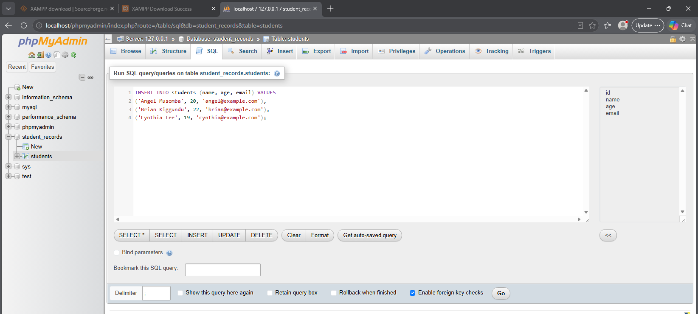

phpMyAdmin confirms that three rows were inserted.

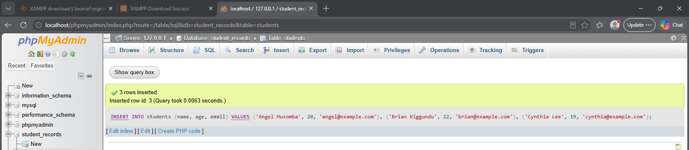

The Browse tab shows the three students with ids 1, 2 and 3.

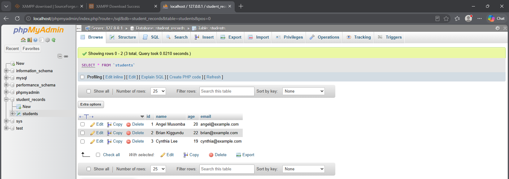

I also checked the data with two more commands. `SELECT * FROM students;` returns every row, and `DESCRIBE students;` returns the table structure as text.

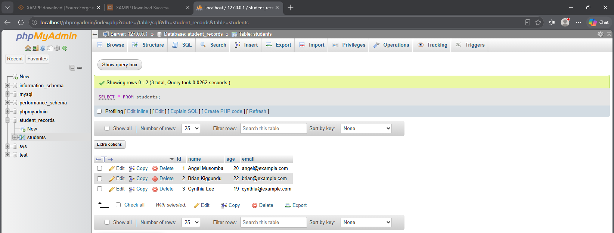

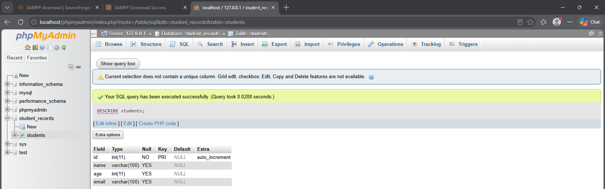

## Step 6: Connect PHP to the database

The file `db.php` holds the connection details in one place, so every other page can reuse them. In the repository I include `db.example.php`, and the real `db.php` is excluded through `.gitignore` so that credentials never reach GitHub.

```php
<?php
$host = 'localhost';
$user = 'root';
$pass = '';
$db   = 'student_records';

mysqli_report(MYSQLI_REPORT_ERROR | MYSQLI_REPORT_STRICT);

try {
    $conn = new mysqli($host, $user, $pass, $db);
    $conn->set_charset('utf8mb4');
} catch (mysqli_sql_exception $e) {
    error_log($e->getMessage());
    die('Database connection failed.');
}
```

The first four lines say where the database is, who is logging in, the password and which database to open. The `try` block attempts the connection. If it fails, the `catch` block writes the technical detail to a private log and shows visitors only a short, safe message. This avoids leaking information that an attacker could use.

## Step 7: Read the records

The page `index.php` asks the database for every student and shows the results in an HTML table. It also adds an Update link and a Delete button to every row.

```php
<?php
require __DIR__ . '/db.php';
$result = $conn->query('SELECT id, name, age, email FROM students ORDER BY id');
?>
<!DOCTYPE html>
<html lang="en">
<head>
    <meta charset="UTF-8">
    <title>Student Records</title>
</head>
<body>
    <h1>Student Records</h1>
    <table border="1" cellpadding="8" cellspacing="0">
        <tr><th>ID</th><th>Name</th><th>Age</th><th>Email</th><th>Actions</th></tr>
        <?php while ($row = $result->fetch_assoc()): ?>
        <tr>
            <td><?= (int)$row['id'] ?></td>
            <td><?= htmlspecialchars($row['name']) ?></td>
            <td><?= (int)$row['age'] ?></td>
            <td><?= htmlspecialchars($row['email']) ?></td>
            <td>
                <a href="update.php?id=<?= (int)$row['id'] ?>">Update</a> |
                <form method="post" action="delete.php" style="display:inline"
                      onsubmit="return confirm('Delete this student?');">
                    <input type="hidden" name="id" value="<?= (int)$row['id'] ?>">
                    <button type="submit">Delete</button>
                </form>
            </td>
        </tr>
        <?php endwhile; ?>
    </table>
</body>
</html>
```

`htmlspecialchars()` turns special characters into harmless text, which blocks cross site scripting. Forcing the id and age to whole numbers adds another safety check.

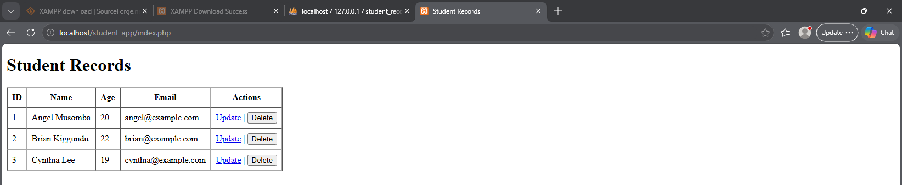

## Step 8: Update a record

The Update link carries the student's id, for example `update.php?id=1`. The page first shows a form with the current email. When the form is submitted, it checks that the new email looks valid, saves it and returns to the records page.

```php
<?php
require __DIR__ . '/db.php';

$id = filter_input(INPUT_GET, 'id', FILTER_VALIDATE_INT)
   ?: filter_input(INPUT_POST, 'id', FILTER_VALIDATE_INT);
if (!$id) { die('Invalid student ID.'); }

$message = '';
if ($_SERVER['REQUEST_METHOD'] === 'POST') {
    $email = trim($_POST['email'] ?? '');
    if (!filter_var($email, FILTER_VALIDATE_EMAIL)) {
        $message = 'Please enter a valid email address.';
    } else {
        $stmt = $conn->prepare('UPDATE students SET email = ? WHERE id = ?');
        $stmt->bind_param('si', $email, $id);
        $stmt->execute();
        header('Location: index.php');
        exit;
    }
}

$stmt = $conn->prepare('SELECT name, email FROM students WHERE id = ?');
$stmt->bind_param('i', $id);
$stmt->execute();
$student = $stmt->get_result()->fetch_assoc();
if (!$student) { die('Student not found.'); }
?>
<!DOCTYPE html>
<html lang="en">
<head>
    <meta charset="UTF-8">
    <title>Update Student Email</title>
</head>
<body>
    <h1>Update Student Email</h1>
    <p>Student: <?= htmlspecialchars($student['name']) ?></p>
    <?php if ($message): ?>
        <p style="color:red"><?= htmlspecialchars($message) ?></p>
    <?php endif; ?>
    <form method="post">
        <input type="hidden" name="id" value="<?= $id ?>">
        <label>New Email:
            <input type="email" name="email" value="<?= htmlspecialchars($student['email']) ?>" required>
        </label>
        <p><button type="submit">Update</button></p>
    </form>
    <a href="index.php">Back to Records</a>
</body>
</html>
```

The question marks in the SQL are placeholders. The database receives the instruction and the data separately, so nothing typed into the email box can be treated as a command. This is called a prepared statement and it protects against SQL injection.

I opened the form for Angel Musomba (id 1) and typed a new email address.

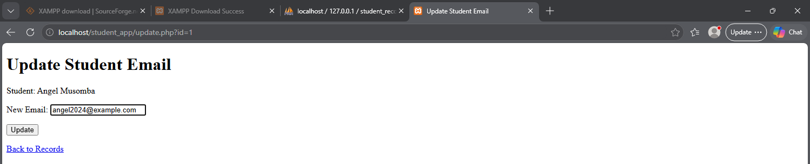

After saving, the records page shows the new email while the other students stay the same.

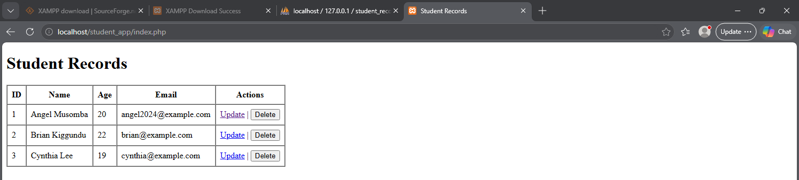

## Step 9: Delete a record

The Delete button sends the student's id to `delete.php`, after a confirmation box asks "Delete this student?".

```php
<?php
require __DIR__ . '/db.php';

if ($_SERVER['REQUEST_METHOD'] !== 'POST') {
    http_response_code(405);
    die('Method not allowed.');
}

$id = filter_input(INPUT_POST, 'id', FILTER_VALIDATE_INT);
if (!$id) { die('Invalid student ID.'); }

$stmt = $conn->prepare('DELETE FROM students WHERE id = ?');
$stmt->bind_param('i', $id);
$stmt->execute();

$msg = $stmt->affected_rows > 0
    ? 'Student deleted successfully!'
    : 'No student found with that ID.';
?>
<!DOCTYPE html>
<html lang="en">
<head>
    <meta charset="UTF-8">
    <title>Delete Student</title>
</head>
<body>
    <p><?= $msg ?> <a href="index.php">Back to Records</a></p>
</body>
</html>
```

The script only accepts a form submission. If someone types its address into the browser, it refuses. I used a button instead of a plain link on purpose, because a link can be triggered by accident or by another website without the user knowing.

I deleted the record for Brian Kiggundu (id 2).

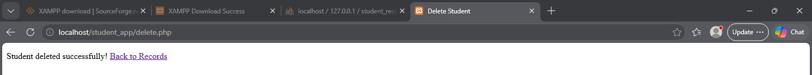

The records page now lists only ids 1 and 3. The database does not renumber the remaining records, so an id always points to one specific student.

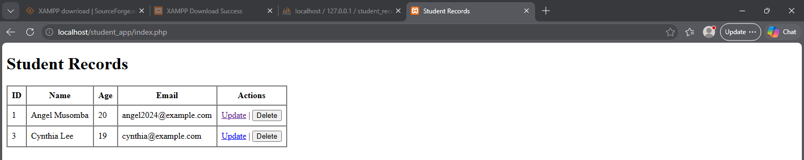

To prove the change happened in the database itself, and not only on the screen, I opened the table in phpMyAdmin. It shows two rows, with Angel's updated email.

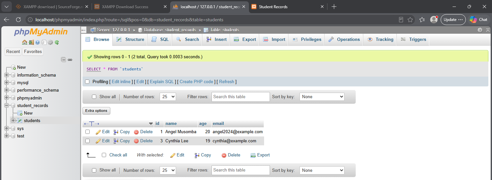

## Project files

The application is made of four small PHP files in one folder.

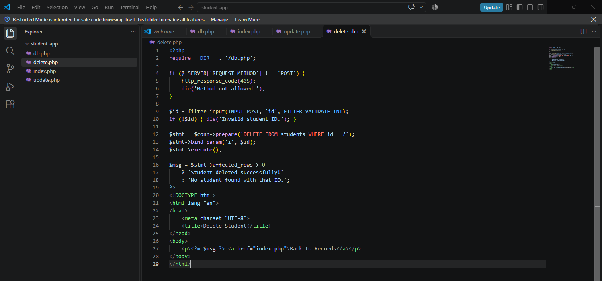

| File | Purpose |
|---|---|
| `db.php` | Connects to the database (kept private, `db.example.php` is included instead) |
| `index.php` | Reads and displays all students |
| `update.php` | Updates a student's email |
| `delete.php` | Deletes a student |

## Results

| CRUD operation | Evidence |
|---|---|
| Create | Screenshots 07, 08 and 09 |
| Read | Screenshots 10, 11 and 12 |
| Update | Screenshots 13 and 14 |
| Delete | Screenshots 15, 16 and 17 |

## Security practices used

* **Prepared statements** on every query that uses user input, to prevent SQL injection.
* **Output escaping** with `htmlspecialchars()`, to prevent cross site scripting.
* **Input validation.** Ids must be whole numbers and emails must look valid before anything is saved.
* **Safer deletes.** Deleting works only through a form submission, with a confirmation step.
* **Safe error messages.** Visitors see a short message and technical details go to a private log.
* **Credentials kept out of GitHub.** The real `db.php` is excluded through `.gitignore`.

Known limits, which I list on purpose. The database account is `root` with no password, which is acceptable for practice on my own machine and never for a real system. The application also has no login and no protection against cross site request forgery yet.

## Run it yourself

1. Install XAMPP and start Apache and MySQL in the Control Panel.
2. Open `localhost/phpmyadmin`, click the SQL tab, paste the contents of `database/schema.sql` and click Go. Run it only once, or the sample students will be added twice.
3. Copy the `src` folder into `C:\xampp\htdocs` and rename it to `student_app`.
4. In that folder, copy `db.example.php` and name the copy `db.php`.
5. Open `localhost/student_app/index.php` in your browser.

## What I learned

Before this project, a database and a web page felt like two separate worlds. Building it showed me how they connect: the page asks a question, PHP carries it to the database, and the answer comes back as a finished page. I learned that user input should always be treated as data and never as instructions, which is why prepared statements and output escaping matter so much. I also saw why CRUD sits behind so much of the software people use every day.

## Next improvements

* Add an "add student" form, so Create also works from the web page.
* Add search, sorting and pagination.
* Rebuild the code with object oriented PHP, using PDO and a Student class.
* Add JSON API endpoints, so other programs can use the data.
* Add login, user roles and protection against cross site request forgery.
* Create a dedicated database user with limited permissions instead of using root.
