<p align="center">
  
</p>

# Base64 Automation Scripts in Bash

**Project 3.1 in Module 3: Bash Scripting Essentials**

| Item | Detail |
|---|---|
| Programme | AfricaHackOn and Cyber Guard Africa training, course AH 200 |
| Environment | Kali Linux running in VirtualBox |
| Languages and tools | Bash, Python 3 as a backup, nano, ShellCheck, diff |
| Scripts | [`encode_base64.sh`](encode_base64.sh) and [`decode_base64.sh`](decode_base64.sh) |
| Data | Sample passwords only. No real credentials were used |

## Short write up

This project contains two Bash scripts. The first, `encode_base64.sh`, asks for a file of passwords with one per line, and writes a second file where each password has been converted to Base64. It keeps the original order and skips empty lines. The second, `decode_base64.sh`, does the reverse. Both use the standard `base64` tool when it exists and switch to Python 3 when it does not, and both stop with a clear message and a failure code when something is wrong. I tested them with ten sample passwords, with deliberately messy files (blank lines, Windows line endings, special characters and broken Base64), with bad file names and permissions, and on simulated systems that lack the usual tools. Every test and its result is shown in the screenshots below.

Testing found three real problems. A blank line above the first line of the script stopped Bash from running it, which let hidden Windows characters leak into the results. Choosing the same file for input and output would have wiped the file while the script still reported success. And on my machine the `base64` tool accepted a broken string and returned junk without complaint. I found each one by testing, traced the cause with debugging tools, fixed it and ran the tests again to confirm. The details are in the section called Three problems that testing found.

## What this is about, in plain language

Computers often need to move data through systems that only handle plain text. Base64 is a way of rewriting any data using just 64 ordinary characters so it can travel safely. A good comparison is writing a message in a different alphabet that everyone knows how to read. The message looks different, but anyone can read it straight back. That is why Base64 is encoding and not encryption. It hides nothing.

This matters in security work because Base64 is often mistaken for protection. If a password is stored as Base64, it is effectively stored in plain sight. This project builds two small tools that convert in both directions. More importantly, it is practice in writing scripts that behave safely when things go wrong.

## What the scripts do

**The encoder, `encode_base64.sh`**

1. Asks for an input file and an output file.
2. Checks the input before doing any work: a name was given, the file exists, it is a normal file, it can be read, an output name was given, and the output is not the same file as the input.
3. Chooses a method. It uses the `base64` tool when available and Python 3 if not, and stops with a clear message if neither exists.
4. Creates the output file, then reads the input line by line from top to bottom.
5. Removes hidden Windows characters, skips empty lines, encodes each line and writes it to the output.
6. Prints how many lines it encoded.

**The decoder, `decode_base64.sh`**

1. Asks for the same two file names and runs the same input checks.
2. Finds the right decode option for the computer. Different systems use `--decode`, `-d` or `-D`, so the script tries each one on a tiny test string and keeps the first that works. If none works, it falls back to Python 3.
3. Checks each line follows the rules of Base64 before decoding it.
4. Decodes good lines. For a bad line it writes a short placeholder such as `[DECODE ERROR: input line 2 is not valid Base64]` and carries on.
5. Prints how many lines it decoded, with a warning if any were replaced by a placeholder.

Both scripts exit with code 0 when they finish and code 1 when a fatal error stops them. The decoder also finishes with code 0 when some lines were replaced by placeholders, because it was designed to carry on, but it prints a clear warning with the count.

## How to run them

```
chmod +x encode_base64.sh decode_base64.sh
./encode_base64.sh
./decode_base64.sh
```

Each script asks two questions. To try the sample data, run the encoder from this folder and answer `sample-data/passwords.txt` for the input and `encoded.txt` for the output. Then run the decoder with `encoded.txt` as the input and `decoded.txt` as the output. The decoded file should match the original exactly.

## Part A: Building and testing the encoder

### A1. Setting up the sample data

I created `passwords.txt` with the ten sample passwords from the exercise. They are common weak passwords used only for practice.

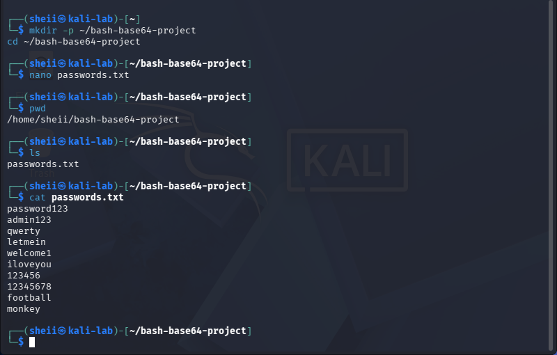

*Screenshot 1. The project folder is created and the sample password file is shown with cat.*

### A2. The first version: asking questions and checking input

The first version of the encoder only asked for file names and checked them. Giving it a file that does not exist produced a clear error message, and `echo $?` showed the exit code was 1, which means failure.

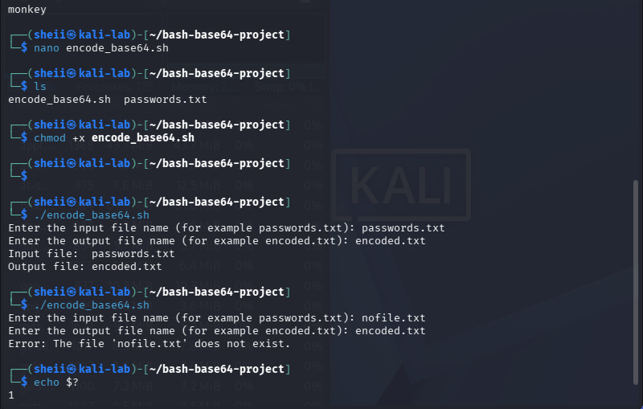

*Screenshot 2. An early run of the script, ending with a clear error and exit code 1.*

### A3. The first successful encoding

After adding the encoding step, the script converted all ten passwords. To prove the result is correct, I decoded the first line by hand with the `base64` tool and got `password123` back.

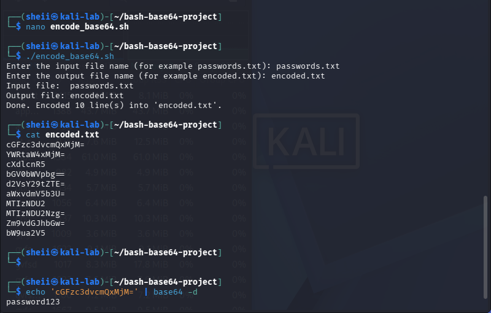

*Screenshot 3. Ten lines encoded, then the first one decoded by hand to confirm it.*

### A4. Error handling tests

A good script fails safely. I fed the encoder several kinds of bad input and checked that each one produced a clear message and exit code 1:

* A folder given instead of a file
* An empty output file name
* An output folder that does not exist
* A file the user is not allowed to read

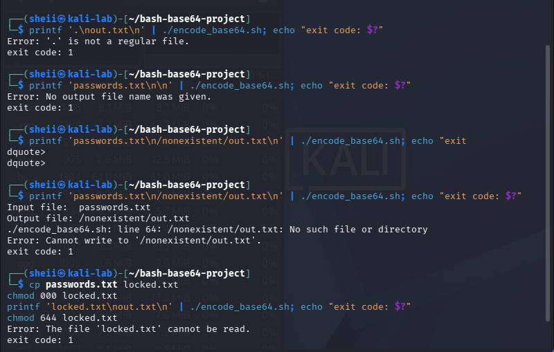

*Screenshot 5. Each bad input is refused with a plain message and exit code 1.*

### A5. Proving the Python backup

The brief asks for a fallback to Python 3. The Kali machine has the `base64` tool, so I simulated a computer without it by giving the script a restricted list of folders to search. The script chose Python, and its output was identical to the normal tool's output. When I removed both tools, the script stopped with a clear message, exit code 1, and did not create an output file.

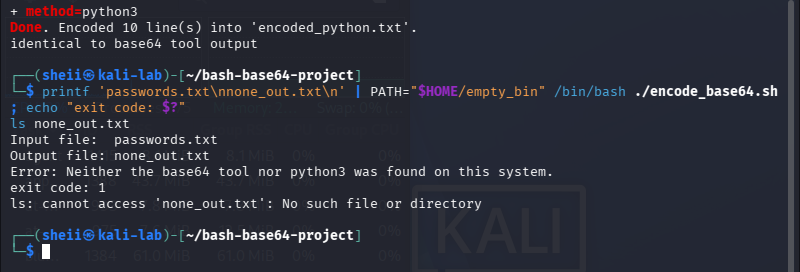

*Screenshot 7. The Python path matches the normal tool, and a missing tool is handled cleanly.*

## Part B: Building and testing the decoder

### B1. Setup and finding the right decode option

The first half of the decoder reads the file names, checks the input and detects how this system decodes Base64. On Kali it chose `--decode`. The empty answer at the top of the screenshot was an accidental slip on my part, and it shows the empty name check working.

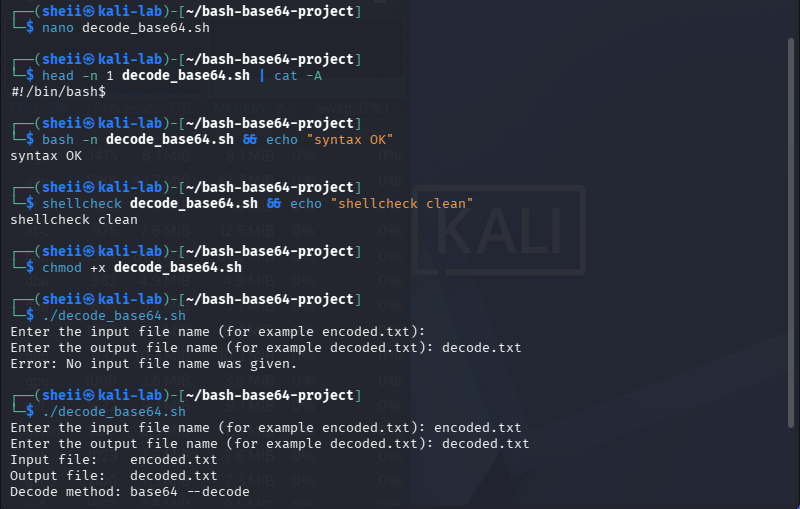

*Screenshot 9. The decoder checks its input and reports the decode method it found.*

### B2. Round trips

A round trip means text goes in as plain text, becomes Base64, and comes back as plain text. If the final file is identical to the starting file, both scripts work together. The comparison tool `diff` stays silent when files match, and I added a message that prints only on a match. Both the passwords and the tricky special characters passed.

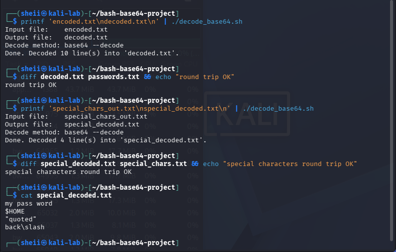

*Screenshot 10. The decoded files match the originals, special characters included.*

### B3. Portability

The decoder had to work on different systems. I ran it with Python only and the results matched the normal tool, even on broken input. I then built a stand in for an older macOS `base64` tool that only understands `-D`. The script tried the other options, was refused, and settled on `-D`, and the round trip still passed. This is a simulation and not a test on a real Mac.

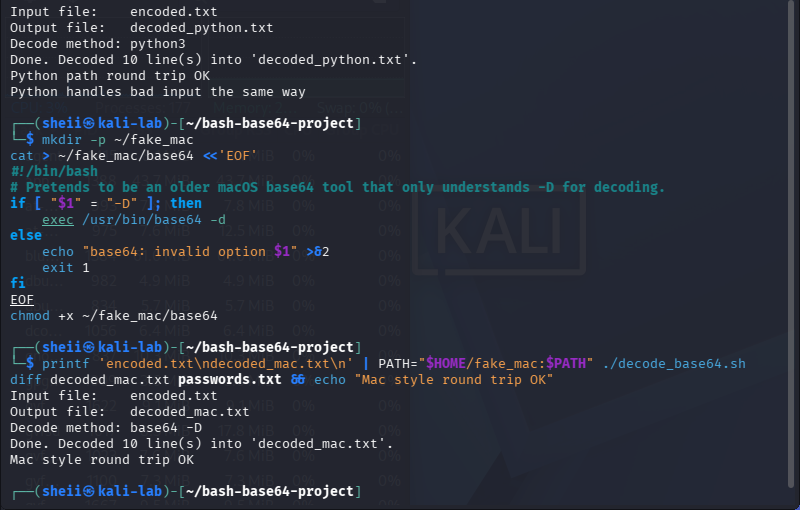

*Screenshot 12. The decoder adapts to the tools available on the system.*

## Part C: Three problems that testing found

### Problem 1: Hidden Windows characters in the results

**What I saw.** I tested a file with Windows style line endings. The encoded results ended in `DQ==`, for example `YWJjDQ==` instead of the correct `YWJj`.

**Why it happens.** Windows ends each line with an invisible extra character called a carriage return. The script has a line that removes it, and that line was correct.

**How I found the cause.**

* `cat -A` made the hidden character visible as `^M`, so it really was in the input.
* Running the script in debug mode with `bash -x` showed the cleanup line working properly.
* Running the same test with `bash ./script` gave correct results, but running `./script` gave wrong ones. So the difference was in who was running the script, not in the code.
* The first line of the file turned out to be blank.

**The cause.** The shebang line only works when `#!` are the first two characters of the file. With a blank line above it, the system no longer treated the file as a Bash script. The program that ran it instead did not understand the notation used for the carriage return.

**The fix.** Delete the blank line so that `#!/bin/bash` is line 1. After that, all four messy input tests passed.

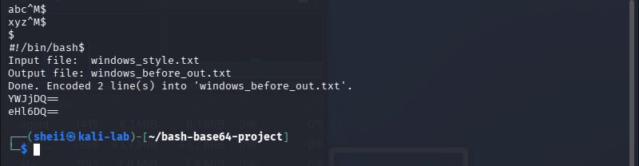

*Screenshot 4a. Before the fix: the blank line above the shebang and the wrong results.*

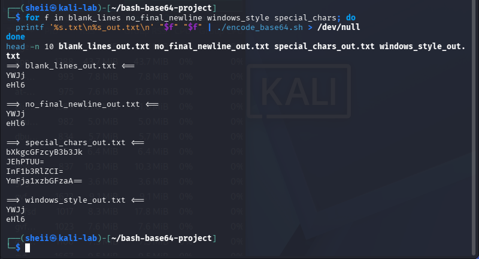

*Screenshot 4b. After the fix: blank lines skipped, a missing final line break handled, Windows characters removed and special characters kept.*

**What I learned.** A script can behave differently depending on how it is launched. The shebang decides which program runs it, so it has to be exactly right.

### Problem 2: A script that wipes its own input and says it succeeded

**What I saw.** I tested what happens if a user types the same file name for both input and output. The file dropped from 86 bytes to 0. The script then printed "Done" and returned exit code 0, which means success. It destroyed the data and reported that everything went well.

**The cause.** The script empties the output file before it starts reading. When input and output are the same file, the input is emptied before the first line is read.

**The fix.** A new check runs before the output file is touched. It uses the `-ef` test, which asks whether two names point to the same file. That is better than comparing typed text, because `file.txt` and `./file.txt` are different spellings of one file. The script now refuses with a clear message and exit code 1, and the file stays untouched. I added the same check to the decoder from the start.

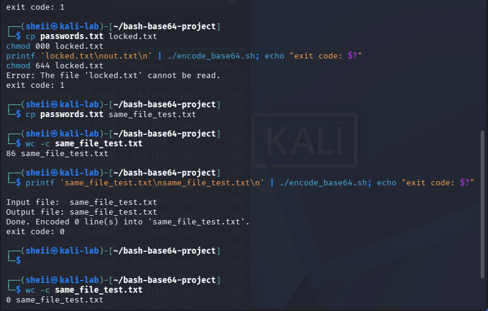

*Screenshot 6a. Before the fix: the file is emptied and the script reports success.*

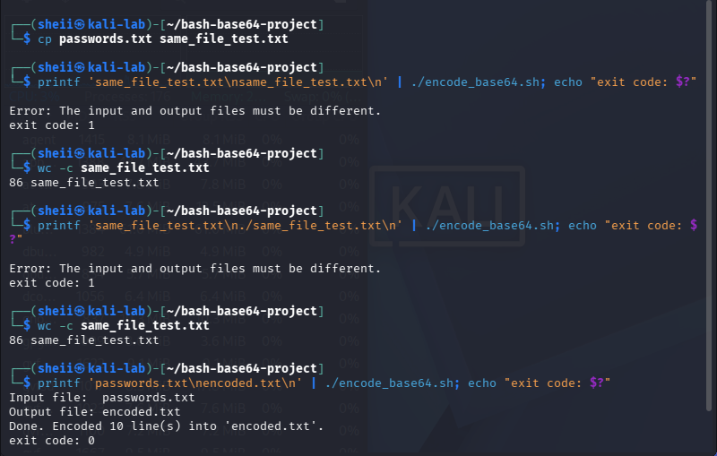

*Screenshot 6b. After the fix: both spellings are refused, the file keeps all 86 bytes, and a normal run still works.*

**What I learned.** Never write into a file you are still reading from. A script should also fail loudly. A script that reports success while destroying data is worse than one that crashes.

### Problem 3: Broken Base64 accepted without a complaint

**What I saw.** My decoder test file included the line `abc`, which is not valid Base64, because the length must be divisible by four. I expected it to be flagged. Instead, on my machine the `base64` tool accepted it, reported success and returned a junk character. The Python method would have rejected the same line, so the two methods disagreed on identical input.

**The cause.** Different versions of the `base64` tool are more or less forgiving about broken input. The script was trusting the tool to validate the data.

**The fix.** I added a small function, `is_valid_base64`, that checks the rules itself before any decoding happens: only the allowed characters, at most two equals signs and only at the very end, and a length divisible by four. Now both methods behave identically.

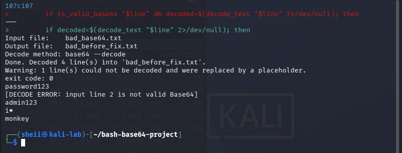

*Screenshot 11a. Before the fix: a one line difference proven with diff, four lines decoded and a junk character where a broken line should have been flagged.*

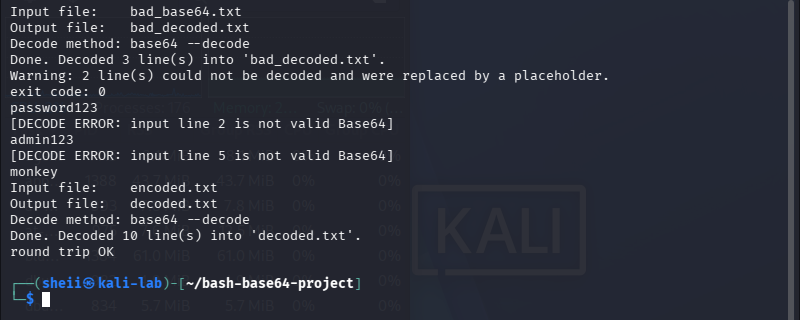

*Screenshot 11b. After the fix: two broken lines are flagged, three good lines are decoded, and the normal round trip still passes.*

**What I learned.** Do not rely on a tool to validate input. Check the rules yourself before processing anything. This is the same principle behind input validation in secure software.

### A note on how the screenshots were made

The original captures of Problem 1 and Problem 3 were not saved at the time. Screenshots 4a and 11a were recreated afterwards from copies of the scripts with the fix removed, and they show the behaviour I observed live. Screenshots 4b and 8 were retaken at the end with the final scripts, because the first versions were cut off. All other screenshots were captured as the work happened.

## Part D: Quality checks

Before finishing, I ran two checks on both scripts. `bash -n` checks the grammar without running anything, and ShellCheck is a linter that warns about likely mistakes. Both scripts passed both checks.

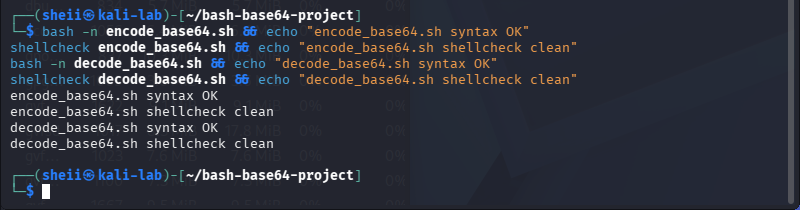

*Screenshot 8. Both scripts pass the syntax check and the linter with no warnings.*

## What I learned

* Base64 is encoding and not encryption. It protects nothing.
* Testing with messy input finds problems that tidy input never shows.
* Debugging tools such as `cat -A`, `bash -x`, `diff` and ShellCheck turn guessing into evidence.
* The shebang line matters, and it has to be the very first thing in the file.
* A script should fail loudly, with a clear message and a non zero exit code.
* Tools differ between systems, so a script that has to be portable should check the rules for itself.

## Limits and ideas for next time

* The decoder finishes with exit code 0 even when some lines were replaced by placeholders. A different exit code for that case could help automated use.
* Both scripts ask questions interactively. Accepting file names as arguments would make them easier to use in larger scripts.
* The decoder assumes the decoded data is text. Binary data would need different handling.
* The older macOS test was a simulation. A test on a real Mac would be the next step.

## Responsible use

All passwords in this project are sample values from a practice exercise, or values I made up for tests. The work was done in my own virtual machine for learning. Base64 must never be used to protect real credentials.

## Files in this project

| Path | What it is |
|---|---|
| `encode_base64.sh` | The encoder script |
| `decode_base64.sh` | The decoder script |
| `sample-data/` | The sample passwords and their encoded version |
| `test-data/` | The messy and broken inputs used for testing, with a short guide |
| `screenshots/` | The evidence screenshots shown above |

## Evidence index

| Screenshot | What it shows |
|---|---|
| `01-sample-passwords-file.png` | The sample password file is created |
| `02-error-handling-missing-file.png` | A missing file is refused with exit code 1 |
| `03-encoder-first-successful-run.png` | The first successful encoding and a manual decode check |
| `04a-edge-cases-before-fix.png` | Problem 1: wrong results caused by a blank first line |
| `04b-edge-cases-after-fix.png` | Problem 1 fixed: all four messy input tests pass |
| `05-error-handling-tests.png` | Four kinds of bad input are refused safely |
| `06a-same-file-flaw-before-fix.png` | Problem 2: the input file is wiped and success is reported |
| `06b-same-file-flaw-after-fix.png` | Problem 2 fixed: the file is protected |
| `07-python-fallback-tests.png` | The Python backup works and a missing tool is handled |
| `08-syntax-and-lint-checks.png` | Both scripts pass the syntax check and ShellCheck |
| `09-decoder-setup-and-flag-detection.png` | The decoder detects its decode method |
| `10-decoder-round-trip-tests.png` | Round trips match, special characters included |
| `11a-decoder-bad-input-before-fix.png` | Problem 3: a broken line slips through |
| `11b-decoder-bad-input-after-fix.png` | Problem 3 fixed: broken lines are flagged |
| `12-decoder-portability-tests.png` | Python path and simulated older macOS both work |
